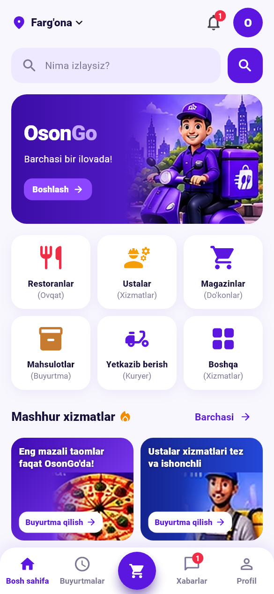
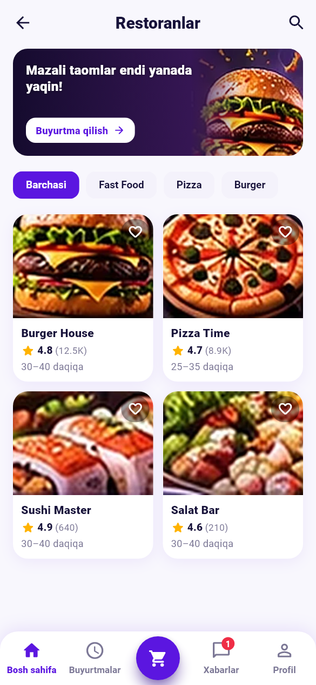
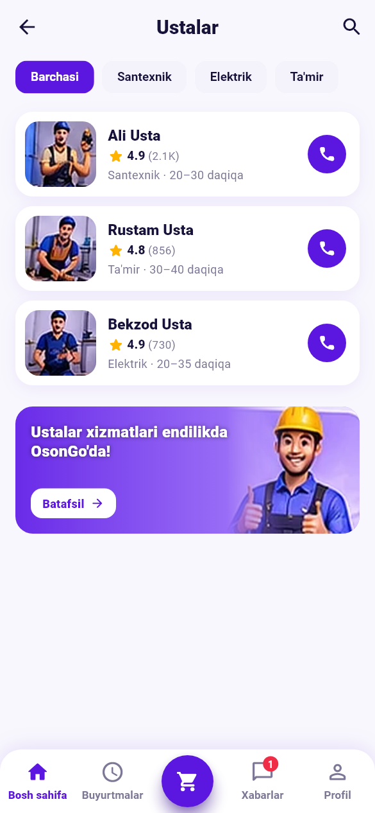
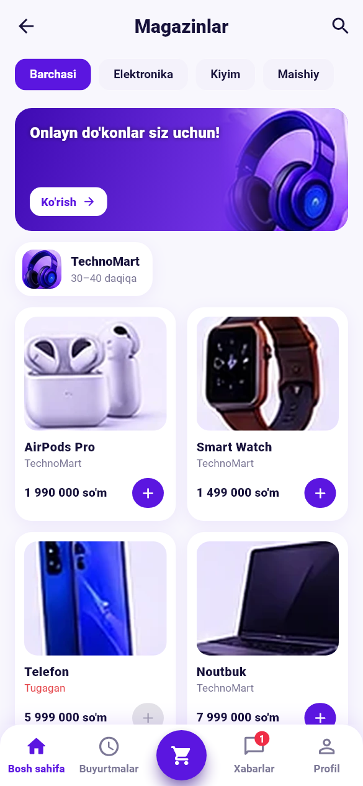
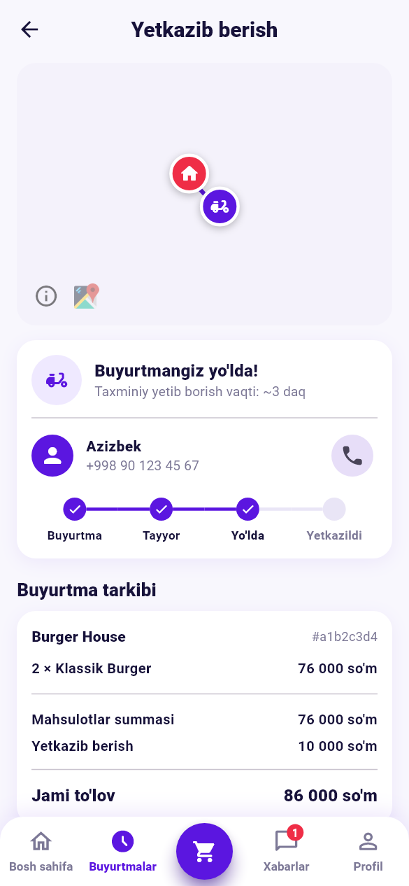
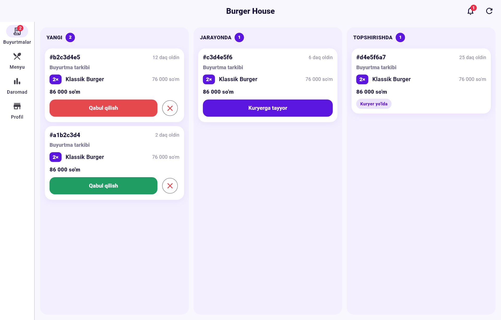
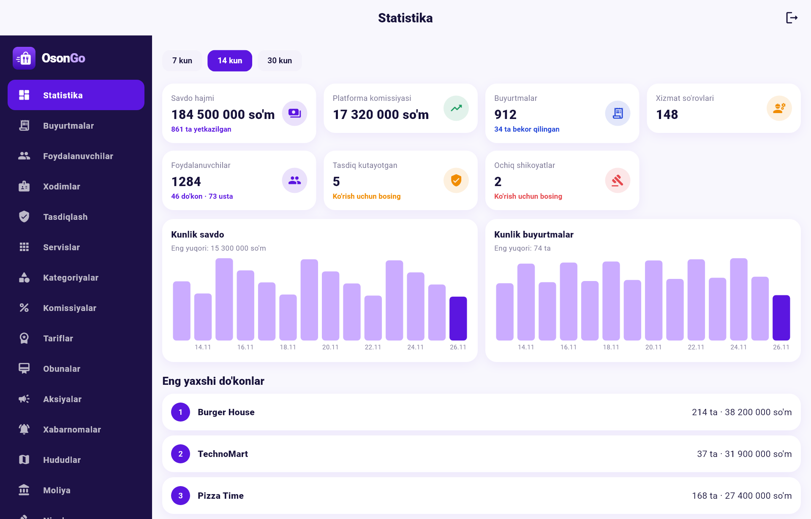

# OsonGo — barchasi bir ilovada

Ovqat, ustalar, magazinlar va yetkazib berishni birlashtirgan super-ilova.
**Flutter + Riverpod + GoRouter + Supabase.** Bitta kod bazasidan uchta ilova
yig'iladi: mijoz, hamkor va Super Admin.

| Bosh sahifa | Restoranlar | Ustalar | Magazinlar | Kuzatuv |
|---|---|---|---|---|
|  |  |  |  |  |

| Restoran: buyurtmalar taxtasi | Super Admin: statistika |
|---|---|
|  |  |

> Skrinshotlar testlarda **namunaviy ma'lumot** bilan chizilgan (xarita
> kafellari testda yuklanmaydi). `assets/images/` dagi rasmlar dizayn
> maketidan kesib olingan vaqtinchalik namunalar — ishga chiqarishdan oldin
> sifatli rasmlarga almashtiring.

## Mundarija

- [Imkoniyatlar](#imkoniyatlar)
- [Tez boshlash](#tez-boshlash)
- [Ma'lumotlar bazasi](#malumotlar-bazasi)
- [Testlar](#testlar)
- [Arxitektura](#arxitektura)
- [Xavfsizlik](#xavfsizlik)
- [Hali qilinmagan](#hali-qilinmagan)

## Imkoniyatlar

### Mijoz (`lib/main_customer.dart`)

- Restoranlar va taomlar, magazinlar va mahsulotlar, bitta savat va buyurtma.
- Ustalar: yo'nalish bo'yicha tanlash, qo'ng'iroq, uyga chaqirish.
- Yetkazib berishni kuzatish: bosqichlar, kuryer joylashuvi va telefoni.
- Mahsulot va xizmat buyurtmalari tarixi, baholash, shikoyat.
- Xabarlar, hudud tanlash, sevimli do'konlar.

### Hamkor (`lib/main_partner.dart`)

| Rol | Panel | Imkoniyatlar |
|---|---|---|
| Restoran egasi | `/restaurant` | Buyurtmalar taxtasi (qabul / rad / tayyorlanmoqda / kuryerga tayyor), menyu va narxlar, kunlik va oylik daromad, tarix |
| Magazin egasi | `/restaurant` | Yuqoridagilar + **ombor qoldig'i** va kam qoldiq ogohlantirishi |
| Usta | `/master` | Yangi so'rovlar, mijoz manzili, ish holati, narx, daromad, baholar |
| Kuryer | `/courier` | Yangi vazifalar, xarita va manzil, holatlar, daromad, joylashuvni ulashish |

Har bir hamkor tekshiruv uchun hujjat yuklaydi va admin xabarlarini oladi.

### Super Admin (`lib/main_admin.dart`)

| Modul | Vazifasi |
|---|---|
| Statistika | Savdo, komissiya, buyurtmalar, kunlik diagramma, eng yaxshi do'konlar |
| Buyurtmalar | Barcha buyurtma va xizmat so'rovlari, bekor qilish |
| Foydalanuvchilar | Qidirish, rol berish, bloklash |
| Xodimlar | Restoran, magazin, usta va kuryer hisobini yaratish / chiqarish |
| Tasdiqlash | Do'kon va ustalarni tasdiqlash, hujjatlar, alohida komissiya |
| Servislar | Bosh sahifa bo'limlarini yaratish, tahrirlash, o'chirish |
| Kategoriyalar | Kategoriya va subkategoriya |
| Komissiyalar | Har bir servis uchun foiz |
| Tariflar / Obunalar | Hamkor tariflari va biriktirish |
| Aksiyalar | Reklama kampaniyalari va chegirma bannerlari |
| Xabarnomalar | Rol bo'yicha yoki hammaga xabar |
| Hududlar | Viloyat, shahar, tuman |
| Moliya | Komissiya, to'lov, qaytarish qaydlari |
| Nizolar | Shikoyatni ko'rib chiqish va qaror |
| Firibgarlik | Qoidaga asoslangan shubhali holatlar |

## Tez boshlash

Kerak: Flutter (stable, Dart ≥ 3.13), VS Code + Flutter kengaytmasi yoki
Android Studio, Supabase loyihasi.

```bash
git clone https://github.com/oyatillosadullayev55-u/FoodGO.git
cd FoodGO
flutter pub get
```

### VS Code

Papkani oching, **Run and Debug** (`Ctrl+Shift+D`) bo'limida konfiguratsiyani
tanlang: *Mijoz · Chrome*, *Hamkor · Chrome*, *Super Admin · Chrome* yoki
Android variantlari. Test va tahlil: **Terminal → Run Task**.

### Terminal

```bash
# Veb
flutter run -d chrome -t lib/main_customer.dart
flutter run -d chrome -t lib/main_partner.dart
flutter run -d chrome -t lib/main_admin.dart

# Android
flutter run --flavor customer -t lib/main_customer.dart
flutter run --flavor partner  -t lib/main_partner.dart
flutter run --flavor admin    -t lib/main_admin.dart
```

### Supabase manzili

Standart qiymat [`lib/core/constants/env.dart`](lib/core/constants/env.dart) da.
O'z loyihangiz uchun `env.example.json` dan `env.json` yarating (u gitga
kirmaydi):

```bash
flutter run -d chrome -t lib/main_customer.dart --dart-define-from-file=env.json
```

## Ma'lumotlar bazasi

> Asosiy jadvallar (`profiles`, `restaurants`, `categories`, `products`,
> `orders`, `order_items`) va `create_order()` funksiyasi Supabase loyihasida
> **oldindan mavjud bo'lishi kerak** — ularning DDL'i bu repoda yo'q.

Dashboard → **SQL Editor** da fayllarni shu tartibda ishga tushiring:

| # | Fayl | Vazifasi |
|---|---|---|
| 1 | `supabase/seed_demo.sql` | Demo restoran va taomlar (ixtiyoriy) |
| 2 | `supabase/roles_setup.sql` | Rollar, RLS, buyurtma holati funksiyalari |
| 3 | `supabase/super_app.sql` | **Super-app:** magazin, usta, servislar, admin modullari |
| 4 | `supabase/seed_super_demo.sql` | Demo magazinlar, ustalar, hududlar (ixtiyoriy) |

Ishga tushirishdan oldin zaxira nusxa oling. Skriptlar qayta ishga
tushirilishi mumkin. **`roles_setup.sql` ni qayta ishga tushirsangiz, undan
keyin `super_app.sql` ni ham qayta ishga tushiring** (birinchisi RLS
siyosatlarini qayta yozadi).

`roles_setup.sql` dagi admin emailini o'zingiznikiga moslang (fayl ichida
bir necha joyda uchraydi).

Keyin xodim yaratish funksiyasini joylang:

```bash
supabase functions deploy admin-create-user
```

`super_app.sql` ishga tushirilmaguncha restoranlar oqimi avvalgidek ishlaydi,
yangi bo'limlar esa "baza hali tayyorlanmagan" xabarini ko'rsatadi. Yangi
yaratilgan do'kon va usta admin tasdiqlamaguncha mijozlarga ko'rinmaydi.

### Buyurtma va xizmat holatlari

```
Buyurtma: pending → accepted → preparing → ready_for_pickup
          → courier_assigned → picked_up → on_the_way → delivered
Xizmat:   new → accepted → on_the_way → in_progress → completed
```

Bekor qilingan yoki rad etilgan buyurtmada ombor qoldig'i qaytariladi.
`delivered` va `completed` holatida komissiya serverda hisoblanadi.

## Testlar

```bash
flutter analyze
flutter test                      # logika va barcha asosiy ekranlar
cd tool/sql_test
npm install
npm test                          # SQL va ruxsatlar (xotiradagi Postgres)
```

- Ekran testlari telefon, tor telefon (320 px) va desktop o'lchamida
  layout xatolarini ushlaydi. Skrinshot olish:
  `flutter test --dart-define=SCREENSHOTS=true` → `build/screenshots/`.
- SQL testlari haqiqiy Supabase'ga ulanmaydi: asosiy jadvallarning soxta
  nusxasida (`tool/sql_test/stubs.sql`) ishlaydi. Shuning uchun haqiqiy
  bazangizdagi tuzilish farq qilsa, avval sinov loyihasida tekshiring.

## Arxitektura

```
lib/
├── main_customer.dart · main_partner.dart · main_admin.dart
├── core/            router, tema, umumiy widgetlar (ui.dart), yordamchilar
├── models/          buyurtma, do'kon, mahsulot, marketplace modellari
├── repositories/    Supabase bilan ishlash (UI to'g'ridan-to'g'ri so'rov yubormaydi)
└── features/
    ├── auth/        kirish, rol bo'yicha yo'naltirish
    ├── customer/    bosh sahifa, katalog, ustalar, savat, buyurtmalar
    ├── restaurant/  restoran va magazin paneli
    ├── master/      usta paneli
    ├── courier/     kuryer paneli
    ├── partner/     hamkor panellarining umumiy qismi
    ├── marketplace/ umumiy providerlar
    └── admin/       Super Admin
supabase/            SQL va Edge Function
tool/                SQL testlari, ikonka generatori
```

- Magazin `restaurants` jadvalida `kind = 'shop'` bilan saqlanadi, shuning
  uchun savat, buyurtma, kuryer va daromad oqimi restoran bilan umumiy.
- Oddiy admin modullari bitta tavsifdan quriladi
  ([`features/admin/resources.dart`](lib/features/admin/resources.dart)):
  yangi jadval boshqaruvi uchun `AdminResource` qo'shish kifoya.

## Xavfsizlik

- Rol `profiles.role` dan olinadi; mijoz uni o'zgartira olmaydi.
- Barcha jadvallarda RLS. Admin ruxsati server tomonda `is_admin()` bilan
  tekshiriladi — ilovadagi tekshiruv faqat qulaylik uchun.
- Buyurtma va xizmat holati faqat RPC orqali o'zgaradi.
- Hamkor o'z tasdiq holati, komissiyasi va reytingini o'zgartira olmaydi.
- Hujjatlar yopiq `partner-docs` bucket'ida; faqat egasi va admin ko'radi.
- `service_role` kalitini ilovaga yoki repoga qo'ymang.

> ⚠️ **Eski o'rnatishlar uchun muhim.** `roles_setup.sql` va `super_app.sql`
> da ruxsat siyosatlari bo'yicha xavfsizlik tuzatishlari bor. Ularni bazada
> imkon qadar tez qayta ishga tushiring.

## Hali qilinmagan

- **Onlayn to'lov yo'q** — faqat naqd. Moliya moduli hisob-kitobni qayd etadi,
  pul o'tkazmaydi.
- Aksiyadagi chegirma foizi bannerda ko'rsatiladi, buyurtma summasiga
  **qo'llanmaydi**. Promokod yo'q.
- Obuna tariflari qayd etiladi, avtomatik cheklov yoki to'lov yo'q.
- Hudud tanlovi hozircha katalogni filtrlamaydi.
- Xabarnomalar ilova ichida; push yuborish (FCM) server qismi sozlanmagan.
- Xaritadagi chiziq to'g'ri chiziq, taxminiy vaqt shu masofadan hisoblanadi.
- Kuryer joylashuvi faqat panel ochiq turganda yuboriladi (fon rejimi yo'q).
- Daromad buyurtma **yaratilgan** sana bo'yicha guruhlanadi.
- Profil sahifasidagi "OsonGo Club" ballari va ba'zi menyu bandlari namuna.
- iOS flavorlari sozlanmagan.

Qo'shimcha: [kirish va email sozlamalari](docs/AUTH.md) ·
[uchta ilova haqida](APPS.md)
