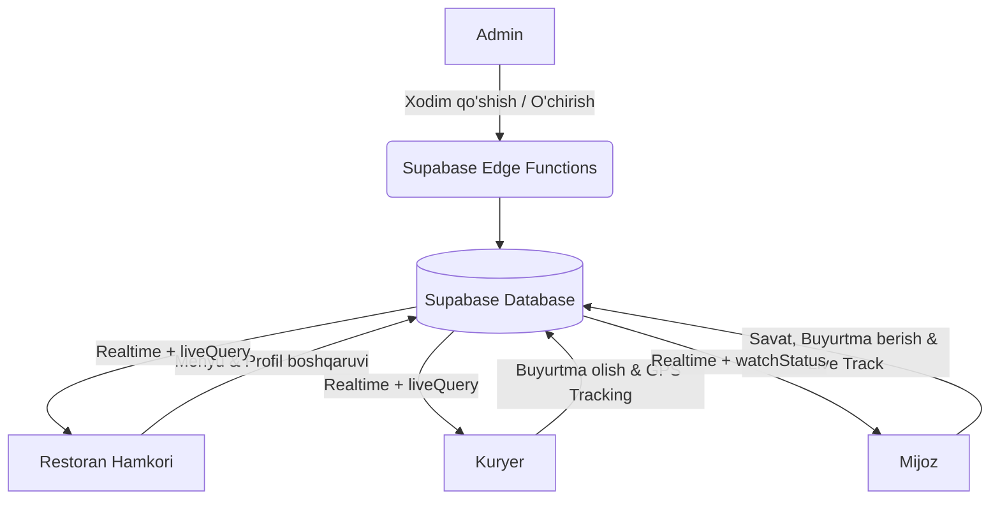
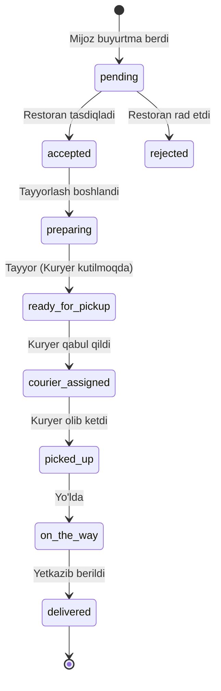
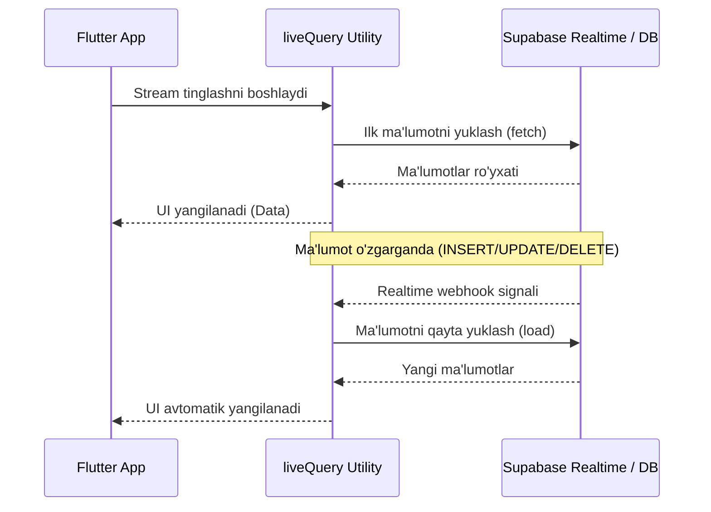
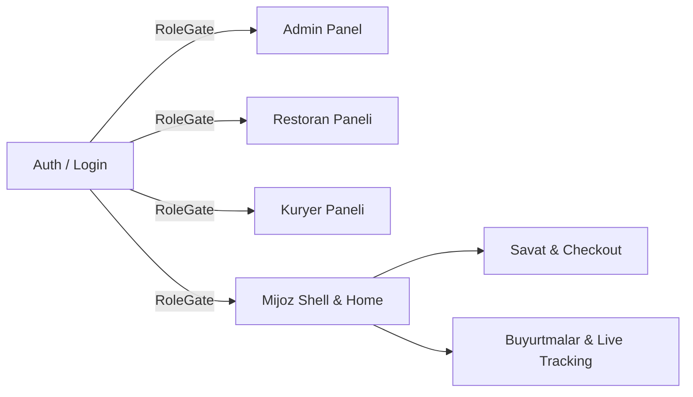

# FoodGo Delivery Platform — Visual Presentation & Architecture Diagrams

> 💡 *Ushbu hujjat taqdimot va slaydlar uchun vizual sxemalar (Mermaid Diagrams) va arxitektura oqimlarini o'z ichiga oladi.*

---

## 1. 🌐 Tizim Arxitekturasi va Rollar Oqimi (System Architecture)

---

## 2. 🍔 Buyurtma Hayot Tsikli (Order Lifecycle Workflow)

---

## 3. 👥 Foydalanuvchi Rollari va Huquqlar Matrikasi

| Rol (Role) | Asosiy Vazifasi | Ruxsat etilgan Sahifalar |
| :--- | :--- | :--- |
| **👑 Admin** | Restoran va kuryer xodimlarini boshqarish | `/admin` (Admin Panel) |
| **🍔 Restoran** | Menyu, taomlar, narx va ish vaqtini boshqarish | `/restaurant` (Restoran Paneli) |
| **🚴 Kuryer** | GPS orqali yaqin atrofdagi buyurtmalarni olish va yetkazish | `/courier` (Kuryer Paneli) |
| **👤 Mijoz** | Restoranlardan taom tanlash, savat va buyurtma berish | `/customer/home` (Mijoz Ilovasi) |

---

## 4. ⚡ Real-Time Ma'lumot Oqimi (`liveQuery` & Polling)

---

## 5. 📱 Ilova Ekranlari Tuzilishi (Screen Hierarchy)

